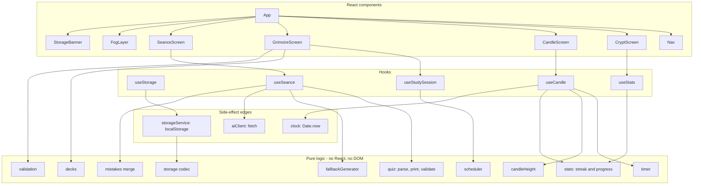
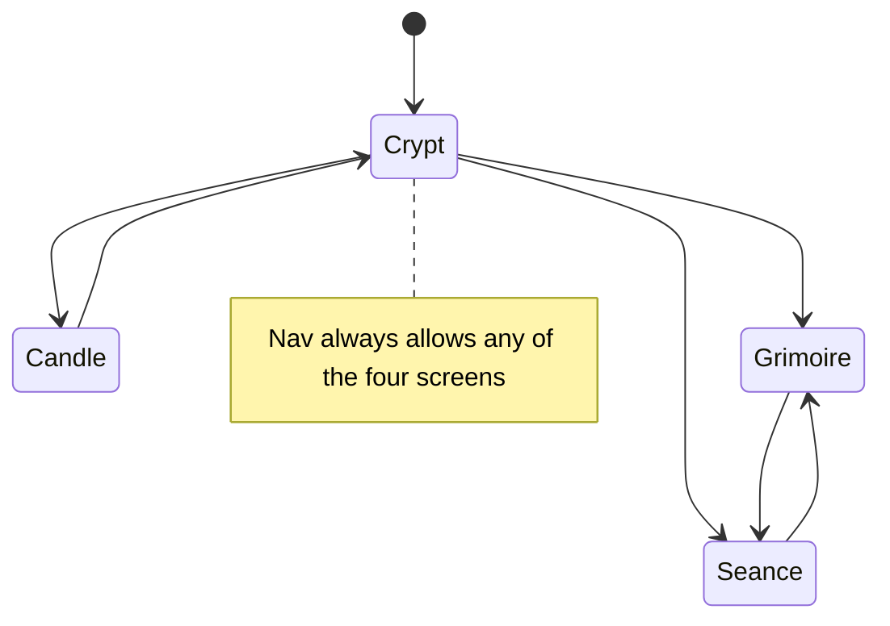
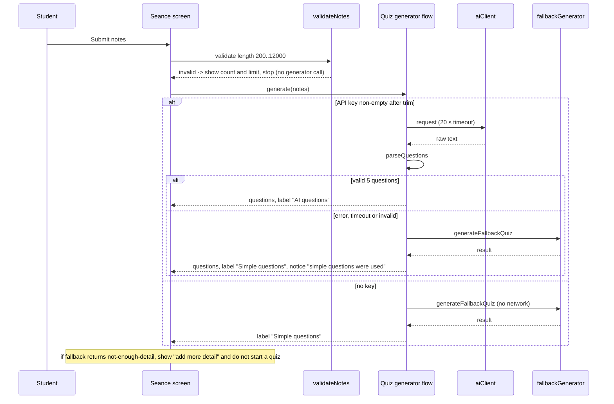

# Design Document

## Overview

Crypt Keeper is a single page, Halloween themed study app built with React and Vite. It runs fully in the browser, persists everything in `localStorage`, and has no login and no backend. The only network call is an optional request to an AI API when a key is present in `.env`.

The app has four screens: the Crypt (home stats), the Candle (focus timer), the Grimoire (flashcards) and the Seance (AI quiz).

### Design Goals

- Keep all business logic in pure TypeScript-free JavaScript modules (no React, no DOM, no `Date.now()` calls inside) so they are easy to unit test and property test.
- Keep React components thin. They call pure modules and a small set of hooks.
- Inject time, randomness and storage so tests are deterministic.
- Make each module small enough to be built and tested as one task.

### Research Summary

- **Vite env variables**: Vite only exposes variables prefixed with `VITE_` through `import.meta.env`. The key will be `VITE_AI_API_KEY`. Note that any `VITE_` value is bundled into client code, so the key is visible to anyone using the built app. This is acceptable for a local, personal app, and the README must say so. Source: [Vite env and modes](https://vitejs.dev/guide/env-and-mode).
- **Testing**: Vitest shares Vite config, runs once with `vitest run`, and works with jsdom and React Testing Library. `fast-check` is the standard property-based testing library for JavaScript and integrates with Vitest. Sources: [Vitest](https://vitest.dev/), [fast-check](https://fast-check.dev/).
- **Timer accuracy**: Browsers throttle `setInterval` in background tabs. The timer therefore stores an end timestamp and computes remaining time from `Date.now()` on every tick (Requirement 2.12).
- **Reduced motion**: Handled in CSS with `@media (prefers-reduced-motion: reduce)` and in JS through `window.matchMedia` where needed.
- **AI provider**: The requirements do not name a provider. The design isolates it behind one `aiClient` module with a single `fetch` call, so the provider can be chosen at build time. Default assumption: an OpenAI compatible chat completions endpoint configured by `VITE_AI_API_URL`, `VITE_AI_MODEL` and `VITE_AI_API_KEY`. Only the key decides AI versus fallback (Requirement 10.5).

### Key Design Decisions

| Decision | Rationale |
| --- | --- |
| Plain JavaScript with JSDoc types, ES modules | Small setup, matches "Vite and React" requirement. Types are documented in JSDoc and in this document. |
| No router library, a `screen` state value | Four screens, no deep links needed. Satisfies "without a full page reload" with little code. |
| Pure `logic/` layer, hooks layer, components layer | Property tests target the pure layer. |
| Storage wrapper never throws | Requirement 13.4 and 13.5. Returns a result object instead. |
| One versioned envelope per key | Requirement 13.2. Allows migration later. |
| Timer stores `endTimestamp` | Requirement 2.12. |
| Scheduler is a pure reducer on a queue | Makes Requirement 8 directly property testable. |
| AI response format is a JSON array parsed by `parseQuestions`, with `printQuestions` as inverse | Requirement 10.10 and 10.11. |

## Architecture



### Folder Layout

```
src/
  main.jsx
  App.jsx
  styles/ (theme.css, fog.css, candle.css, layout.css)
  logic/
    timer.js            // countdown math, session switching
    candleHeight.js     // height percentage
    stats.js            // streak, today progress, soul points
    validation.js       // length rules for names, cards, notes, minutes
    decks.js            // deck and card operations (immutable)
    scheduler.js        // review queue
    quiz.js             // Question validation, parseQuestions, printQuestions
    fallbackGenerator.js
    mistakes.js         // merge wrong answers into "Seance Mistakes"
    storageCodec.js     // encode/decode versioned envelopes
  services/
    storageService.js   // localStorage access, never throws
    aiClient.js         // fetch with timeout
    clock.js
  hooks/
    useStorage.js, useCandle.js, useStats.js, useStudySession.js, useSeance.js
  components/
    Nav, FogLayer, StorageBanner, CandleVisual, Ghost, ...
  screens/
    CryptScreen, CandleScreen, GrimoireScreen, SeanceScreen
tests/
  unit/, property/
.env.example
README.md
```

### Screen Flow



## Components and Interfaces

Interfaces use JSDoc style signatures. All logic functions are pure and return new values.

### App Shell (Requirement 1, 14, 15)

- `App`: holds `screen` state (`'crypt' | 'candle' | 'grimoire' | 'seance'`). Default `'crypt'`. Wraps screen rendering in an error boundary. If a screen throws, the previous screen stays visible and an error message "This screen could not be loaded" shows (Req 1.5). Implementation: `setScreen` is applied only after a successful render of the target; the error boundary reverts `screen` to the last good value.
- `Nav`: four buttons or links labeled Crypt, Candle, Grimoire, Seance. Active one has `aria-current="page"` and an active class. Fixed to bottom under 768 px, top or side at 768 px and above, through CSS media queries.
- `FogLayer`: `position: fixed; inset: 0; z-index: 0; pointer-events: none; aria-hidden="true"`. Animation disabled under `prefers-reduced-motion: reduce`.
- `StorageBanner`: shows "Progress may not be saved" when `storageService` reports a failure (Req 13.5). Rendered in an `aria-live="polite"` region.

### Theme and Accessibility (Requirement 14, 15)

CSS custom properties in `theme.css`:

- Background: `hsl(275, 40%, 12%)` family (hue 260 to 290, lightness at or below 20%).
- Accent: `hsl(120, 60%, 55%)` family (hue 90 to 150).
- Headings: a Google font such as "Creepster" or "Nosifer" with fallback `'Georgia', serif`. Loaded with `font-display: swap` so text is visible while loading and falls back if loading fails (Req 14.7).
- Body: system sans-serif stack at `font-size: 1rem` (16 px) minimum.
- Focus: `:focus-visible { outline: 3px solid <accent>; outline-offset: 2px; }`.
- Touch targets: `min-width: 44px; min-height: 44px` on buttons, links, inputs, toggles.
- `html, body { overflow-x: hidden; }` is NOT used to hide overflow. Layouts use `max-width: 100%`, `box-sizing: border-box` and wrapping so that no horizontal scroll appears at 320 px.
- Contrast: body text is near white (`hsl(270, 20%, 92%)`) on the dark background, which comfortably exceeds 4.5:1. Fog uses low opacity so the lightest area behind text stays dark.

### Storage (Requirement 13)

`storageCodec.js` (pure):

```js
/** @param {string} key  @param {any} data  @returns {string} JSON text */
encode(data, version = 1)        // -> JSON string of { version, data }
/** @returns {{ ok: true, data: any } | { ok: false, reason: string }} */
decode(text, validate, supportedVersions = [1])
```

`storageService.js` (side effect edge):

```js
load(key, defaults, validate) // -> { value, error?: string }; never throws
save(key, data)               // -> { ok: true } | { ok: false, error: string }; never throws
isAvailable()                 // -> boolean
```

Keys (all prefixed `cryptkeeper:`):

| Key | Content |
| --- | --- |
| `cryptkeeper:settings` | `{ studyMinutes, breakMinutes }` |
| `cryptkeeper:stats` | `{ soulPoints, streak, lastStudyDay, todayDay, todaySessions, todayMinutes }` |
| `cryptkeeper:decks` | `{ decks: Deck[] }` |

Behavior:

- `load`: missing key, invalid JSON, wrong shape or unsupported version returns the defaults and does NOT overwrite the stored value (Req 13.4). A later successful `save` replaces it.
- `save`: on `setItem` throw (quota or unavailable) returns `{ ok: false }`. `useStorage` then raises the banner and callers keep state in memory (Req 13.5).
- Shape validators live next to each data type.

`useStorage(key, defaults, validate)` returns `[value, setValue, status]`. It holds the value in React state, writes through `save`, and exposes `status.error`.

### Timer and Candle (Requirement 2, 3, 4)

`logic/timer.js` (pure; time passed as argument):

```js
defaultSettings = { studyMinutes: 25, breakMinutes: 5 }

/** @returns {{ ok: true, value: number } | { ok: false, message: string }} */
parseMinutes(input, kind /* 'study' | 'break' */)  // whole number, study 1..120, break 1..60

/** Timer state: { mode: 'study'|'break', status: 'idle'|'running'|'paused', remainingMs, endTimestamp|null } */
start(state, now)        // endTimestamp = now + remainingMs, status running
pause(state, now)        // remainingMs = max(0, endTimestamp - now), status paused
reset(state, settings)   // remainingMs = full length of current mode, status idle
tick(state, now)         // running: remainingMs = max(0, endTimestamp - now)
isFinished(state)        // running and remainingMs === 0
completeSession(state, settings) // switch mode, full length of new mode, status idle
applyLengthChange(state, settings) // if not running, remainingMs = full length of current mode
formatMMSS(remainingMs)  // "MM:SS", rounds up to the next whole second
```

`logic/candleHeight.js`:

```js
/** @returns {number} percentage in [0, 100] */
candleHeightPercent(remainingMs, totalMs) // if totalMs is not a finite number > 0 -> 100; else clamp(remaining/total*100, 0, 100)
```

`useCandle()`:

- Runs a `setInterval` of 250 ms while status is `running`, calling `tick(state, clock.now())`. Because remaining time is derived from the end timestamp, background throttling cannot cause drift beyond one tick (Req 2.12). It also listens to `visibilitychange` to tick immediately on return.
- On `isFinished`: if mode was `study`, call `stats.recordStudySession(stats, minutes, todayKey)` and save; show the completion message with the new Soul Point total (kept until dismissed or next start, Req 4.9); announce "Session ended" through an `aria-live="assertive"` region (Req 15.6); then `completeSession`.
- If saving stats fails, show "progress was not saved" and keep updated values in memory (Req 4.10).
- Reset during a study session never touches stats (Req 4.3).

`CandleVisual` renders an SVG candle. Height from `candleHeightPercent`. Flame shown only when `status === 'running'` and `remainingMs > 0`. Has `role="img"` and `aria-label` such as "Candle, 40 percent remaining". Under reduced motion the flame is static (Req 3.7) via CSS.

### Stats: Soul Points, Streak, Today Progress (Requirement 4, 5)

`logic/stats.js` (pure; days are local date keys `YYYY-MM-DD`):

```js
dayKey(date)                         // local YYYY-MM-DD
daysBetween(dayKeyA, dayKeyB)        // whole calendar days, B - A, computed from UTC of the date parts to avoid DST errors
normalizeStats(stats, todayKey)      // rolls Today_Progress to 0 when todayDay !== todayKey; sets streak 0 if daysBetween(lastStudyDay, today) > 1
recordStudySession(stats, minutes, todayKey) // +1 soul point; progress += 1 session and minutes; streak rules
```

Streak rules in `recordStudySession`, after normalizing:

| Condition | Result |
| --- | --- |
| `lastStudyDay` null or streak 0 | streak = 1, lastStudyDay = today |
| `daysBetween(last, today) === 1` | streak + 1, lastStudyDay = today |
| `daysBetween(last, today) === 0` | streak unchanged |
| `daysBetween(last, today) > 1` | streak = 1 (it was already reset to 0 by normalize), lastStudyDay = today |

`CryptScreen` uses `useStats`. It calls `normalizeStats` on open and also schedules a timer to the next local midnight (plus a safety check on `visibilitychange`) to refresh Today_Progress within 1 second (Req 5.4). On load failure it shows zeros, an error message, and keeps the three links (Req 5.8). Exactly three links: start Candle, open Grimoire, open Seance.

### Validation

`logic/validation.js`:

```js
validateName(text)       // trim, 1..100 -> { ok, value } | { ok: false, field: 'name', message }
validateCardText(text, field) // trim, 1..500; field is 'front' | 'back'
validateNotes(text)      // length rules 200..12000 (untrimmed length, as pasted) -> { ok } | { ok: false, message with count and limit }
```

### Grimoire: Decks and Cards (Requirement 6)

Model operations in `logic/decks.js` are pure and immutable. Each returns `{ ok: true, decks }` or `{ ok: false, error }`; the invalid case returns the original decks untouched.

```js
createDeck(decks, name, id, now)
renameDeck(decks, deckId, name)
deleteDeck(decks, deckId)
addCard(decks, deckId, front, back, id)
editCard(decks, deckId, cardId, front, back)
deleteCard(decks, deckId, cardId)
incrementMiss(decks, deckId, cardId)
```

IDs and timestamps are passed in (generated by `crypto.randomUUID()` at the edge) so the functions stay pure. `GrimoireScreen` saves through `useStorage` after every successful operation. On a failed save, the in-memory decks stay as they are and an error message shows (Req 6.10). A load failure starts with an empty list.

Deck list shows `deck.cards.length` (0 for none). Delete uses a confirm step.

### Grimoire: Study Mode and Review Scheduler (Requirement 7, 8)

`logic/scheduler.js` (pure; randomness injected as `rng: () => number` in [0,1)):

```js
/** Initial queue: higher missCount first, random order among equals. */
buildQueue(cards, rng)  // -> QueueEntry[]  where QueueEntry = { cardId, confirmed: false, missedThisSession: false }

/** Apply a result to the head entry. */
applyResult(queue, result /* 'got' | 'missed' */, rng) // -> { queue, removed: boolean }
```

`applyResult` rules (head entry is index 0; it is taken off first, then reinserted into the remaining queue `rest`):

| Result | Entry state | Action |
| --- | --- | --- |
| missed | any | `confirmed = false`, `missedThisSession = true`. Insert at index `k` of `rest` where `k` is random in `[0, 2]` (that is 1 to 3 positions after the current position), capped at `rest.length` (end of queue). (8.1, 8.5) |
| got | `missedThisSession = false` | Remove (8.2) |
| got | `missedThisSession = true`, `confirmed = false` | `confirmed = true`; insert at index `max(4, ...)` of `rest`, which is at least 5 positions after the current position, capped at `rest.length` (8.3) |
| got | `confirmed = true` | Remove (8.4) |

Position clarification: if the current card is at position 0, then "n positions after the current position" is position n in the original numbering, which is index `n - 1` in `rest`. So "1 to 3 after" maps to `rest` indexes 0 to 2, and "at least 5 after" maps to `rest` index 4 or greater. With a fixed choice of exactly 5 after, index is `min(4, rest.length)`. The design uses exactly 5 positions after for the got-after-miss case, which satisfies "at least 5".

The queue is empty when the session ends (8.11). Cards are never dropped other than by "removed" (8.6).

`useStudySession(deck)`:

- On start, if `deck.cards.length === 0`, show an empty-deck message with an add-card control (7.5). Otherwise `buildQueue`.
- Holds `{ queue, flipped, gotCount, missedCount }`.
- `flip()`, `answer(result)`. On `missed`, call `incrementMiss` and save. On save failure, show an error indication and continue with the queue unchanged (8.10).
- Summary shows `gotCount` and `missedCount` when the queue is empty (7.6).
- Keyboard: space on the focused card flips it; buttons are real `<button>` elements so Tab, Enter and Space work and the focus style applies (7.7, 7.8).
- Page turn animation: CSS 3D transform of 500 ms. Under reduced motion it is replaced with an instant swap.

### Seance: Quiz Generation (Requirement 9, 10)

`logic/quiz.js` (pure):

```js
/** Question = { text: string, options: [string, string, string, string], correctIndex: 0|1|2|3 } */
isValidQuestion(q)    // text 1..300, 4 options each 1..150, options distinct (trim + case-insensitive), correctIndex integer 0..3
isValidQuiz(qs)       // array of exactly 5 valid Questions
printQuestions(qs)    // -> JSON string: { "questions": [ { "question", "options": [..4], "answerIndex" } ] }
parseQuestions(text)  // -> { ok: true, questions } | { ok: false, reason }; tolerates a Markdown code fence around JSON, requires exactly 5 valid Questions
```

Round trip contract: for every valid list of 5 Questions, `parseQuestions(printQuestions(qs))` returns `{ ok: true, questions }` deeply equal to `qs` (same text, same option order, same correct index). `printQuestions` does not trim or alter strings; the generators and validators already require strings that survive the round trip. Strings are stored as given (JSON handles escaping).

`services/aiClient.js`:

```js
requestQuestions(notes, { apiKey, url, model, timeoutMs = 20000, fetchImpl = fetch })
// -> Promise<string>  (raw model text); rejects on network error, non-2xx or timeout (AbortController)
```

The prompt asks for exactly 5 multiple choice questions in the JSON format that `parseQuestions` reads.

`logic/fallbackGenerator.js` (pure; `rng` injected):

```js
splitSentences(notes)       // sentences split on . ! ? and newlines; keeps sentences with at least 6 words ("usable")
extractKeyTerms(sentence)   // words of length >= 5, not in a stop-word list, alphabetic; unique, case-insensitive
generateFallbackQuiz(notes, rng)
// -> { ok: true, questions } | { ok: false, reason: 'not-enough-detail' }
```

Algorithm:

1. Compute usable sentences. Compute the notes-wide set of distinct key terms (case-insensitive, first spelling kept).
2. If usable sentences < 5 or distinct key terms < 4, return `not-enough-detail`.
3. Choose 5 distinct sentences (shuffled with `rng`) that each contain at least one key term. If fewer than 5 qualify, return `not-enough-detail`.
4. For each chosen sentence, pick one key term `t` in it. Question text is the sentence with the first whole-word occurrence of `t` replaced by `_____`. Options are `t` plus 3 other distinct key terms (distinct from `t` and each other, case-insensitive), shuffled. `correctIndex` is the position of `t`.
5. Question text is truncated to 300 characters by selecting only sentences whose blanked text is at most 300 characters (sentences longer than that are not usable). Terms are limited to 150 characters, which the 5-letter-or-more word rule plus a maximum word length of 40 guarantees.

Output always passes `isValidQuiz`.

`useSeance()` orchestrates:



- Overall 30 s guard: an outer timeout of 30 s (the AI call is capped at 20 s, so the fallback still has time). If generation fails entirely, show "quiz generation failed", re-enable submit, keep notes, show no partial questions (Req 9.8).
- While generating: loading indicator, submit disabled (Req 9.5).
- Privacy notice "Your notes are sent to an AI service" is displayed whenever the notes input is shown and the key is present (Req 13.7).

### Seance: Quiz Play and Ghost (Requirement 11)

State reducer in `logic/quizPlay.js` (pure):

```js
initPlay(questions)                    // { index: 0, answers: [null x5], finished: false }
selectOption(play, optionIndex)        // ignored if current question already answered
next(play)                             // allowed only if current answered; moves index; after 5th answered -> finished
score(play, questions)                 // count of answers equal to correctIndex
retry(play, questions)                 // same questions, fresh state
```

- Ghost message: separate fixed lists of correct and incorrect messages; the two sets do not overlap (Req 11.5).
- Options are `<button>` elements, so keyboard (Enter, Space) and touch work (11.8).
- Results screen: "N out of 5", Retry control, New notes control (11.4, 11.6).
- Marking and revealing happens synchronously in state update, well inside 200 ms.

### Seance: Save Wrong Answers (Requirement 12)

`logic/mistakes.js` (pure):

```js
MISTAKES_DECK_NAME = 'Seance Mistakes'
/** Adds a Card for each given question not already present (compared by front text). Creates the deck if missing. */
addMistakes(decks, questions, makeId)
// -> { decks, added: number, skipped: number }
```

For each wrong Question: front = `question.text`, back = `question.options[correctIndex]`. A duplicate is a Card in "Seance Mistakes" with identical front text (also within the same batch).

Flow:

- Per question "Save to Grimoire" control appears after a wrong answer and stays visible until the quiz ends (12.1). Selecting it calls `addMistakes` with that one question, then one `save`. If `added === 0`, show "Card already exists" (12.6). Otherwise show confirmation (12.4).
- On save failure: show an error, keep the previously saved decks (the in-memory result of `addMistakes` is discarded), keep the control available (12.5).
- At quiz end, if any wrong answers, show "Save all mistakes". It calls `addMistakes` once with all wrong questions, saves once, and shows "N added, M skipped" (12.7). Not shown if no wrong answers (12.8).

## Data Models

```js
/** Card */
{ id: string, front: string, back: string, missCount: number /* integer >= 0 */ }

/** Deck */
{ id: string, name: string, cards: Card[] }

/** Settings */
{ studyMinutes: number /* 1..120 */, breakMinutes: number /* 1..60 */ }

/** Stats */
{
  soulPoints: number,      // integer >= 0
  streak: number,          // integer >= 0
  lastStudyDay: string | null,  // 'YYYY-MM-DD' local
  todayDay: string | null,      // 'YYYY-MM-DD' the day todaySessions and todayMinutes belong to
  todaySessions: number,   // integer >= 0
  todayMinutes: number     // integer >= 0
}

/** Question */
{ text: string, options: [string, string, string, string], correctIndex: 0 | 1 | 2 | 3 }

/** TimerState (in memory only) */
{ mode: 'study' | 'break', status: 'idle' | 'running' | 'paused', remainingMs: number, endTimestamp: number | null }

/** QueueEntry (in memory only) */
{ cardId: string, confirmed: boolean, missedThisSession: boolean }

/** PlayState (in memory only) */
{ index: number, answers: (number | null)[], finished: boolean }

/** Storage envelope */
{ version: 1, data: <one of the above top-level shapes> }
```

Defaults when data is missing or invalid: `Settings = { 25, 5 }`, `Stats` all zeros and nulls, `decks = []`.

`.env.example`:

```
# Optional. If empty or missing the app uses the built-in simple question generator.
VITE_AI_API_KEY=
VITE_AI_API_URL=https://api.openai.com/v1/chat/completions
VITE_AI_MODEL=gpt-4o-mini
```

`.gitignore` lists `.env` (and `.env.local`).

## Build Task Slicing

To keep work in small, one-at-a-time tasks, the design follows this order. Each step has no dependency on later steps.

1. Project setup: Vite, React, Vitest, fast-check, scripts, `.gitignore`, `.env.example`, README skeleton.
2. Storage codec and service with validators.
3. `validation.js`.
4. `timer.js` and `candleHeight.js`.
5. `stats.js`.
6. `decks.js`.
7. `scheduler.js`.
8. `quiz.js` (validate, print, parse).
9. `fallbackGenerator.js`.
10. `mistakes.js` and `quizPlay.js`.
11. `aiClient.js` and the generation flow.
12. Theme, App shell, Nav, FogLayer, StorageBanner.
13. Candle screen and visual.
14. Crypt screen.
15. Grimoire screens (decks, cards, study mode).
16. Seance screens.
17. Accessibility and responsive pass, README finish.


## Correctness Properties

*A property is a characteristic or behavior that should hold true across all valid executions of a system-essentially, a formal statement about what the system should do. Properties serve as the bridge between human-readable specifications and machine-verifiable correctness guarantees.*

### Property 1: Minutes input validation

*For any* input value and session kind, `parseMinutes` accepts it if and only if it is a whole number within the range for that kind (1 to 120 for study, 1 to 60 for break), and returns that number. For every other input (out of range, fractional, empty, non-numeric) it rejects with a message and no value.

**Validates: Requirements 2.2, 2.3, 2.4**

### Property 2: Timer remaining time depends only on the end timestamp

*For any* running timer state and any later time `now` (including very large gaps that simulate a background tab), `tick` yields `remainingMs = max(0, endTimestamp - now)`, independent of how many ticks happened in between. *For any* running state, `pause` at time `t1` then `start` at time `t2 >= t1` yields a running state with `remainingMs` equal to the value at `t1` and `endTimestamp = t2 + remainingMs`.

**Validates: Requirements 2.5, 2.6, 2.12**

### Property 3: Resets and switches restore full length

*For any* timer state and valid settings, `reset` yields an idle state whose remaining time equals the full configured length of the current mode. `completeSession` yields an idle state in the other mode with the full length of that mode. `applyLengthChange` on a non-running state yields the full new length of the current mode.

**Validates: Requirements 2.7, 2.11, 2.13**

### Property 4: MM:SS formatting

*For any* non-negative remaining time in milliseconds, `formatMMSS` returns a string matching `MM:SS` (minutes at least two digits, seconds 00 to 59) whose total seconds equals the remaining time rounded up to a whole second.

**Validates: Requirements 2.5**

### Property 5: Candle height

*For any* remaining time and total time, `candleHeightPercent` returns a value in `[0, 100]`. When the total is a finite number greater than 0 it equals `remaining / total * 100` clamped to that range. When the total is 0, negative, `NaN` or not a number it returns 100 without throwing. A remaining time of 0 with a valid total returns 0, and remaining equal to total returns 100.

**Validates: Requirements 3.1, 3.3, 3.4, 3.8**

### Property 6: Finishing a study session updates stats

*For any* valid stats, any whole minute length and any day key, `recordStudySession` increases `soulPoints` by exactly 1, increases `todaySessions` by exactly 1 and `todayMinutes` by exactly the minute length (after rolling over progress that belongs to an earlier day).

**Validates: Requirements 4.1, 4.4**

### Property 7: Streak rules

*For any* valid stats and any day gap `g` between `lastStudyDay` and today: if there is no last study day or the streak is 0, a completed study session sets the streak to 1; if `g = 1` the streak increases by exactly 1; if `g = 0` the streak is unchanged; if `g > 1` the streak after the session is 1. In every case `lastStudyDay` becomes today. `daysBetween` is correct across month, year and daylight saving boundaries.

**Validates: Requirements 4.5, 4.6, 4.7, 4.8**

### Property 8: Day rollover normalization

*For any* valid stats and a day key different from the stored `todayDay`, `normalizeStats` sets `todaySessions` and `todayMinutes` to 0 and leaves `soulPoints` unchanged. When the gap from `lastStudyDay` to today is greater than 1 it also sets `streak` to 0. Normalizing twice gives the same result as normalizing once (idempotent).

**Validates: Requirements 4.7, 5.4, 5.7**

### Property 9: Text validation by trimmed length

*For any* string, `validateName` accepts it if and only if its trimmed length is 1 to 100, and `validateCardText` accepts it if and only if its trimmed length is 1 to 500. Accepted results equal the trimmed string. Rejected results name the invalid field.

**Validates: Requirements 6.1, 6.2, 6.4, 6.5, 6.7**

### Property 10: Deck operations

*For any* decks list, an operation given invalid input (empty, whitespace-only or over-length name or text, or an unknown id) returns an error and the original decks unchanged. *For any* valid `renameDeck` or `editCard`, all other decks, cards and card counts are preserved. *For any* `deleteCard`, the deck's card count drops by exactly 1 and the other cards are preserved. *For any* `deleteDeck`, the deck and its cards are gone and all other decks are unchanged. A newly created deck has zero cards.

**Validates: Requirements 6.1, 6.2, 6.3, 6.5, 6.6, 6.7, 6.11**

### Property 11: Initial queue ordering

*For any* deck of cards with miss counts and any random source, `buildQueue` returns a permutation of exactly the deck's cards, and the miss counts along the queue are non-increasing.

**Validates: Requirements 7.1, 8.7, 8.9**

### Property 12: Review scheduler transitions

*For any* non-empty queue and random source, `applyResult` on the head entry behaves as follows:
- `missed`: the card stays in the queue, its confirmed mark is cleared, and it is reinserted at 1 to 3 positions after the current position, or at the end when fewer than 3 cards remain. The queue length is unchanged.
- `got` on a card without a miss this session: the card is removed and the queue length drops by 1.
- `got` on a card with a miss that is not yet confirmed: the card is marked confirmed and reinserted at least 5 positions after the current position, or at the end when fewer than 5 cards remain. The queue length is unchanged.
- `got` on a confirmed card: the card is removed.
In all cases the other cards keep their relative order.

**Validates: Requirements 8.1, 8.2, 8.3, 8.4, 8.5**

### Property 13: Scheduler session completeness

*For any* deck and any sequence of results driven by a random source, a card leaves the queue only through a "got" result that is either its first-try result or a "got" on a confirmed card. The set of cards in the queue is always a subset of the deck. Every simulated session where results eventually contain enough "got" answers ends with an empty queue, and when the queue is empty the session is over.

**Validates: Requirements 8.6, 8.11, 7.6**

### Property 14: Miss count increment

*For any* decks list and any existing card, `incrementMiss` increases that card's `missCount` by exactly 1 and changes nothing else.

**Validates: Requirements 8.8**

### Property 15: Notes length gate

*For any* notes string, `validateNotes` accepts it if and only if its length is 200 to 12000 inclusive. Rejections include the current character count and the relevant limit. When rejected, the generator is not invoked and the notes text is unchanged.

**Validates: Requirements 9.2, 9.3, 9.4**

### Property 16: Question validity

*For any* candidate question, `isValidQuestion` returns true if and only if the text is 1 to 300 characters, there are exactly 4 options of 1 to 150 characters each, the options are pairwise distinct after trimming and ignoring case, and `correctIndex` is an integer from 0 to 3. `isValidQuiz` is true if and only if there are exactly 5 valid questions.

**Validates: Requirements 9.6, 9.7**

### Property 17: Blank key never calls the AI

*For any* key value that is missing, empty or only whitespace, the generation flow does not call `fetch` and produces its result using the fallback generator.

**Validates: Requirements 10.5**

### Property 18: Fallback generator output validity

*For any* notes with at least 5 usable sentences and at least 4 distinct key terms, `generateFallbackQuiz` returns exactly 5 questions that pass `isValidQuiz`. For each question, the text contains exactly the blank marker where a key term was removed, the correct option equals the removed term, the other 3 options are distinct key terms from the notes, and filling the blank with the correct option gives a sentence from the notes.

**Validates: Requirements 10.7, 9.6, 9.7**

### Property 19: Fallback rejects thin notes

*For any* notes with fewer than 5 usable sentences or fewer than 4 distinct key terms, `generateFallbackQuiz` returns `not-enough-detail` and no questions.

**Validates: Requirements 10.8**

### Property 20: Quiz print and parse round trip

*For any* valid list of 5 questions, `parseQuestions(printQuestions(qs))` succeeds and returns a list with equal question text, equal options in the same order and equal correct answer for every question.

**Validates: Requirements 10.10, 10.11**

### Property 21: Parsing invalid text fails safely

*For any* string that is not a valid 5 question response (random text, invalid JSON, wrong counts, duplicate options, wrong option count, out of range answer index), `parseQuestions` returns `{ ok: false }` and never throws.

**Validates: Requirements 10.6, 9.8**

### Property 22: Answering and score

*For any* list of 5 questions and any sequence of option selections, the first selection for a question is recorded and later selections for that question are ignored. `next` is only allowed after the current question is answered. When all 5 are answered, the score equals the count of answers equal to the correct index, and is between 0 and 5.

**Validates: Requirements 11.2, 11.3, 11.4**

### Property 23: Retry resets play state

*For any* finished or partial play state, `retry` returns the same 5 questions with index 0, all answers unanswered and a score of 0.

**Validates: Requirements 11.7**

### Property 24: Saving mistakes to the Grimoire

*For any* decks list and any list of wrong questions, `addMistakes` returns decks in which a deck named "Seance Mistakes" exists, every wrong question has exactly one card there with its question text as front and its correct option text as back, `added + skipped` equals the number of input questions, and cards that were already present (by front text) are not duplicated. Applying `addMistakes` a second time with the same questions adds 0 cards. All other decks are unchanged.

**Validates: Requirements 12.2, 12.3, 12.6, 12.7**

### Property 25: Storage round trip and format

*For any* valid settings, stats or decks object, `decode(encode(x))` returns a value deeply equal to `x`. The encoded text is JSON with an integer `version` of at least 1, and every key written by `storageService.save` starts with `cryptkeeper:`.

**Validates: Requirements 13.1, 13.2, 13.3**

### Property 26: Invalid stored data yields defaults

*For any* stored value that is missing, is not valid JSON, has the wrong shape or has an unsupported version, `load` returns the defaults for that data, does not throw, and leaves the stored value unmodified.

**Validates: Requirements 13.4**

## Error Handling

| Situation | Behavior | Requirement |
| --- | --- | --- |
| Screen render throws | Error boundary keeps the previous screen and shows "This screen could not be loaded" | 1.5 |
| Invalid minutes entry | Reject, keep previous value, show allowed range | 2.4 |
| Settings save or load fails | Use defaults or keep current, keep running, show message | 2.10 |
| Stats save fails after a session | Show "progress was not saved", keep values in memory | 4.10 |
| Stats read fails on Crypt | Show zeros, error message, keep links | 5.8 |
| Invalid deck name or card text | Reject, field-specific message, no change | 6.7 |
| Deck save fails or load fails | Show error; keep in-memory decks on save failure; empty list on load failure | 6.10 |
| Miss count save fails | Continue session, queue unchanged, show indicator | 8.10 |
| Notes too short or too long | No generator call, message with count and limit, notes kept | 9.3, 9.4 |
| AI error, timeout (20 s) or bad response | Discard response, use fallback, show "simple questions were used" | 10.6 |
| Whole generation fails or 30 s passes | "Quiz generation failed", enable submit, keep notes, no partial questions | 9.8 |
| Notes too thin for fallback | Ask for more detail, no quiz | 10.8 |
| Mistakes save fails | Error message, deck unchanged, control stays available | 12.5 |
| Stored data invalid or unsupported version | Defaults, stored value not overwritten until next save | 13.4 |
| localStorage unavailable or quota exceeded | Keep session data in memory, banner within 1 second | 13.5 |
| Custom font fails to load | Fallback font stack | 14.7 |

General rules: logic functions return result objects instead of throwing; `storageService` and `aiClient` catch all errors at the edge; user-facing messages go through `aria-live` regions.

## Testing Strategy

### Approach

Both unit tests and property tests are used. They are complementary: unit tests cover concrete examples, UI flows and integration points; property tests cover the pure logic.

- Runner: Vitest (`npm test` runs `vitest run`, once, no watch).
- Property testing library: `fast-check`. Properties are not implemented from scratch.
- UI tests: React Testing Library with jsdom, plus a fake `localStorage` and mocked `fetch`.
- Each property in this document is implemented as a SINGLE property-based test, configured with at least 100 runs (`fc.assert(..., { numRuns: 100 })` or more).
- Each property test carries a comment tag in this format: `Feature: crypt-keeper, Property N: <property text>`.
- Time, randomness, storage and fetch are injected, so tests are deterministic. For `rng`, tests pass a seeded generator built from fast-check integers.

### Property Test Files

| File | Properties |
| --- | --- |
| `tests/property/timer.property.test.js` | 1, 2, 3, 4 |
| `tests/property/candleHeight.property.test.js` | 5 |
| `tests/property/stats.property.test.js` | 6, 7, 8 |
| `tests/property/decks.property.test.js` | 9, 10, 14 |
| `tests/property/scheduler.property.test.js` | 11, 12, 13 |
| `tests/property/quiz.property.test.js` | 15, 16, 20, 21 |
| `tests/property/fallback.property.test.js` | 18, 19 |
| `tests/property/generation.property.test.js` | 17 |
| `tests/property/quizPlay.property.test.js` | 22, 23 |
| `tests/property/mistakes.property.test.js` | 24 |
| `tests/property/storage.property.test.js` | 25, 26 |

Key generators:

- `arbQuestion`: text 1 to 300 chars, 4 options built with distinct normalized values, `correctIndex` 0 to 3.
- `arbQuiz`: array of exactly 5 `arbQuestion`. Includes strings with quotes, newlines, unicode and JSON special characters to stress the round trip.
- `arbNotes`: built from sentences of generated words, so tests control the number of usable sentences and key terms.
- `arbStats`, `arbSettings`, `arbDecks`: valid objects only.
- `arbGarbage`: arbitrary strings, JSON of wrong shape, bad versions.

### Unit and Integration Tests (examples)

- Navigation: four labeled links on each screen, `aria-current` on the active one, error boundary keeps the previous screen (1.1 to 1.6).
- Candle defaults and restore, storage failure messages (2.1, 2.8 to 2.10).
- Flame shown only when running; candle at 0% hides the flame (3.2, 3.4 to 3.6).
- Study completion message, break leaves points unchanged, reset leaves stats unchanged (4.2, 4.3, 4.9, 4.10).
- Crypt shows stored values, zeros with empty storage, three links, error state (5.1 to 5.3, 5.5 to 5.8).
- Grimoire flows: create, rename, delete with confirm, empty-deck message, study flow with keyboard (6.x, 7.x).
- Seance: loading state disables submit, AI success labels "AI questions", AI failure falls back with notice, thin notes message, privacy notice when a key exists (9.1, 9.5, 9.8, 10.6, 10.8, 10.9, 13.7).
- Quiz play: marking, ghost messages differ, score text "N out of 5", retry and new-notes controls (11.x).
- Save to Grimoire: single save, duplicate message, save failure, save all with counts (12.x).
- No network call other than the AI call (13.6).
- localStorage write failure shows the banner (13.5).

### Smoke Checks

- `.env.example` exists, names all variables, has no real key; `.gitignore` lists `.env` (10.3, 10.4).
- CSS tokens: background hue 260 to 290 and lightness at or below 20%, accent hue 90 to 150, `prefers-reduced-motion` rules exist, focus outline at least 2 px, headings have fallback fonts (14.x, 3.7).
- `npm run build` succeeds with no `.env` file; `npm test` exits 0 on pass and non-zero on failure; README documents Node version, scripts and env variables (16.x).

### Manual Checks

Layout at 320 px and 1920 px (no horizontal scroll), bottom nav under 768 px, 44 px touch targets, contrast under the fog, screen reader names for the candle and Ghost, and keyboard-only use. Full accessibility validation needs manual testing with assistive technologies and expert review; automated tests cover only part of Requirements 14 and 15.
